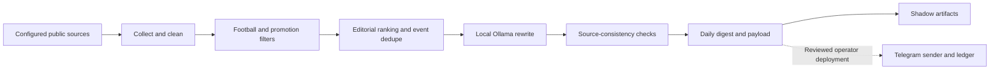

# PremWire

PremWire is a local, text-only football newsroom built in Python. It collects
configured public sources, filters promotional and low-information material,
rewrites selected news in Russian with a local Ollama model, and prepares a
deduplicated daily digest. The public distribution is **dry-run by default**.
Cloning, installing or importing it does not start collectors, models or workers.

## Goals and features

- Preserve source meaning and transfer status rather than inventing news.
- Rank important events; keep independent matches and genuine story developments.
- Suppress duplicates, stale content and owner-deleted stories.
- Bound a finite daily batch and reject ambiguous publication retries.
- Keep credentials, browser profiles and operational SQLite outside source control.

## Architecture



## Implementation status

| Capability | Status |
|---|---|
| Telegram public-feed collection, X API/RSS collection | Implemented; sources disabled in this example |
| Source cleanup, editorial selection, event-stage dedupe | Implemented |
| Russian rewriting through Ollama | Implemented; requires a separately installed model |
| Finite daily Telegram digest, bounded UTF-16 output, at-most-once ledger | Implemented library route; public CLI is shadow-only |
| X browser mirror and VK API mirror | Preserved optional integration code; disabled here |
| Dzen native daily article adapter | Preserved legacy adapter; not wired into the current daily batch |
| Moderation | Optional library code; disabled here |
| Immutable FACT BUNDLE and one-call constrained editing | Experimental, shadow-only; not production-ready |
| Visual generation and media collections | Not included in this text-only distribution |

### Ingestion and editorial selection

Configure only sources you are permitted to access. Telegram collection paginates
public pages toward the daily boundary. X API requires an appropriate bearer
credential; RSS fallback is best-effort and does **not** guarantee whole-day
coverage. The manual X inbox is not automatically polled by the daily batch.
Source failures are isolated and incomplete coverage is reported.

Deterministic ranking considers importance, novelty, recency and story type.
Popularity metadata is a soft preference, not a mandatory publication registry.
There is no quota requiring filler stories.

### Event deduplication and factual checks

Event identity includes participants, fixture context, transfer direction and
development stage. Conflicts are refused rather than silently reconciled.
Publication history, suppression and tombstones prevent exact republication.
Source-local checks detect many unsupported numbers, entities and status changes.
These checks are **not independent fact verification** and cannot establish that
a trusted source itself is truthful. Human editorial oversight remains necessary.

The experimental immutable bundle stores typed facts with SOURCE references and
essential facts. It renders deterministic drafts; constrained Qwen editing cannot
freely replace factual values. Missing source patterns fail closed. Full X/manual
intake coverage and further current-day acceptance remain release blockers.

### Local LLM and daily digest

Ollama runs separately and is not bundled. The example profile uses Qwen 9B with
a 4096-token context; choose a model suitable for your hardware. The existing daily
route rewrites selected stories individually within a deadline. The experimental
bundle route uses one compact batch call and deterministic fallback. Do not
confuse the experimental cost profile with the existing daily route.

The operator library limits delivery to the Moscow evening window, records
`SENDING` before network submission, and refuses automatic retries after an
ambiguous send. This repository does not install a scheduler or activate delivery.
It includes no production history, credentials, models or previously published
content. X/VK/Dzen are not silently enabled for a long daily digest.

## Configuration and development

Python 3.11+ is required. Windows is the primary integration environment; the
encrypted credential store uses Windows DPAPI. Offline core logic is Python.

```powershell
python -m venv .venv
.\.venv\Scripts\python.exe -m pip install --upgrade pip
.\.venv\Scripts\python.exe -m pip install -r requirements.lock
.\.venv\Scripts\python.exe -m pip install -e .
.\.venv\Scripts\python.exe -m premwire.cli status
.\.venv\Scripts\python.exe -m premwire.cli demo
```

`config/settings.json` contains safe example settings; `config/sources.json` has
only a disabled placeholder source. `.env.example` contains names and empty
values. Copy it locally only when credentials are required; never commit values.
`PREMWIRE_RUNTIME` selects your isolated runtime. Its public-copy fallback is
`.runtime` beneath the current working directory, not an existing operator runtime.

The public CLI provides `status`, `demo` and `daily-digest`. There is deliberately
no live-confirm switch, autostart installer or browser login workflow. Enabling
sources and invoking a shadow batch can use network access and start a temporary
Ollama server; that is an explicit action, not an installation side effect.

```powershell
# Requires your own permitted source configuration and local Ollama model.
python -m premwire.cli daily-digest
```

`OLLAMA_BASE_URL` and `OLLAMA_MODEL` optionally override the public shadow CLI
profile without writing settings. Other optional integration variables are listed
in `.env.example`. `API_SPORTS_KEY` is reserved; no photo provider is enabled here.
Do not point a development checkout at an operational runtime or credential store.

## Tests

The prepared CI workflow uses a read-only token and pinned action commits. It runs
offline tests and secret scans of the tree and complete public Git history. Tests
block child processes as well as network sockets; they never start Ollama. Local
public-export tooling keeps the operator checkout as the only development source,
preserves reviewed hardening using three-way merges, and stops on conflicts.
CI is additional detection after a push, not a substitute for pre-push gates.

Tests use temporary state and mocked publishing; no credentials or Ollama server
are needed. The curated public suite focuses on the supported text path; historical
visual, operator-specific and archived-data suites are intentionally not shipped.

```powershell
$env:PYTHONPATH = 'src'
python -m unittest discover -s tests -v
```

On restricted Windows sandboxes, point TEMP/TMP to a writable temporary directory
before running SQLite tests. Test output mentioning a publication is mocked.

## Security

See [SECURITY.md](SECURITY.md). Dry-run is not a security boundary against arbitrary
code execution: operators must review configuration and explicit integration calls.
Keep production state separate, review dependency advisories, and protect browser
sessions as credentials. Never share raw exception traces, source exports or logs
without a separate privacy review. Revocation is necessary after credential exposure;
removing a file or Git commit alone is insufficient.

## Roadmap

- Complete and observable daily X/manual-source coverage.
- Wider deterministic SOURCE patterns and more natural, fact-preserving Russian.
- Current-day immutable-bundle end-to-end acceptance before operator activation.
- A dedicated daily Dzen adapter with exact delivery mappings.
- Portable integration tests and tighter dependency/security baselines.

## License

Original PremWire source code is licensed under [MIT](LICENSE).
This grant excludes third-party media, emblems, trademarks, model weights, source
content and dependencies. None of those materials are bundled. See
[THIRD_PARTY_NOTICES.md](THIRD_PARTY_NOTICES.md) for scope and operator responsibilities.
